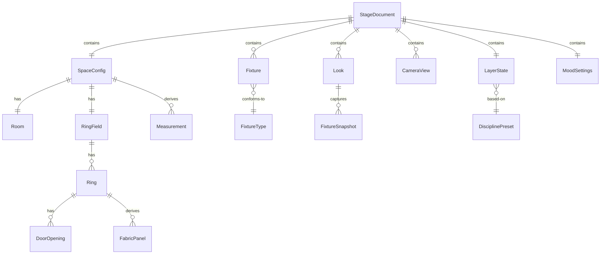

# Phase 1 Data Model: Stage Visualizer & Designer Components

**Feature**: 005-stage-visualizer-components | **Date**: 2026-08-09

All entities are plain serialisable JavaScript objects. Nothing in this model imports Three.js —
that is the boundary that makes measurement testable in Node, the floorplan panel and the 3D view
consistent, and the design file trivially exportable.

Units are metres and degrees throughout. Angles follow the existing plan convention: **0° = +x,
90° = +z (toward the entrance), counter-clockwise**. The `CylinderGeometry` conversion (angles from
+Z clockwise) happens only inside `space/ringBuilder.js` and never leaks into this model.

---

## Entity overview



---

## 1. StageDocument

The complete saved design. The unit of export, import, and autosave.

| Field | Type | Notes |
|---|---|---|
| `schemaVersion` | integer | Starts at `1`. Loader branches on this. |
| `meta` | object | `{ name, createdAt, modifiedAt, author?, note? }` |
| `space` | `SpaceConfig` | Required |
| `fixtures` | `Fixture[]` | Includes installation fixtures and user-added ones |
| `looks` | `Look[]` | May be empty |
| `views` | `CameraView[]` | May be empty |
| `mood` | `MoodSettings` | Global exposure and bloom |
| `layers` | `LayerState` | Visibility plus active discipline preset |
| `analysis` | object | `{ circulationMode, flowRouteIndex }` — preserves the existing modes |

**Validation**
- `schemaVersion` must be an integer the loader recognises; unknown → reject with an explanation.
- Missing optional sections load as documented defaults and are reported as substitutions.
- Any `Look` or `CameraView` referencing an absent fixture id loads with that entry omitted and
  the omission reported (FR-026).

**Lifecycle**: created on export, consumed on import, and mirrored (minus `meta`) into
`localStorage` by autosave.

---

## 2. SpaceConfig

The physical model of the installation. Everything the architect can change.

| Field | Type | Notes |
|---|---|---|
| `room` | `Room` | Shell and height |
| `ringField` | `RingField` | Curtain rings and their centre |
| `screen` | `ScreenConfig` | Projection screen — not a curtain ring |
| `entrance` | `{ x, z, width, source }` | Default from `DOOR_M` |
| `technical` | object | Niches, ducts, booth — from `TECHNICAL` |
| `provenance` | object | Per-field `'confirmed' \| 'derived' \| 'estimated'` map |

### 2.1 Room

| Field | Type | Default | Source |
|---|---|---|---|
| `width` | number (m) | `10.12` | confirmed |
| `depth` | number (m) | `22.34` | confirmed |
| `wallHeight` | number (m) | current `WALL_H` | **estimated** |
| `nearHalfWidth`, `farHalfWidth` | number (m) | trapezoid taper | estimated |

The room is a trapezoid; `halfWidthAtZ(z)` interpolates between the two half-widths. This is the
only place the taper is defined.

### 2.2 RingField

| Field | Type | Notes |
|---|---|---|
| `center` | `{ x, z }` | Default `CENTER_M` = `{ 0.08, 6.69 }` |
| `rings` | `Ring[]` | Ordered innermost → outermost |
| `growthFactor` | number | Multiplier used when generating radii |
| `gapWidthM` | number (m) | Physical door width, converted to an angle per ring |
| `openingSpacingDeg` | number | Global spacing for generated openings |
| `clipToRoom` | boolean | Whether geometry is clipped at the walls |

**Invariant**: `rings[i].radius < rings[i+1].radius`. Violating this is a validation error, not a
silent reorder.

### 2.3 Ring

| Field | Type | Notes |
|---|---|---|
| `index` | integer | Position from the centre, 0-based |
| `radius` | number (m) | Ring 1 confirmed at `3.2665` (Ø6.533) |
| `height` | number (m) | Tapers: `CURTAIN_H − min(index, 10) × 0.06` |
| `doors` | `DoorOpening[]` | Angular positions |
| `visible` | boolean | |
| `trim` | `{ mode: 'auto' \| 'manual', startDeg?, endDeg? }` | Restricts fabric to the in-room span |
| `source` | `'confirmed' \| 'derived' \| 'estimated'` | Ring 1 confirmed; outer dashed radii estimated |

### 2.4 DoorOpening

| Field | Type | Notes |
|---|---|---|
| `angleDeg` | number | Centre of the opening, plan convention |
| `widthDeg` | number (derived) | `2·asin((gapWidthM/2) / radius)` in degrees |
| `usable` | boolean (derived) | False when the opening falls outside the room |

### 2.5 FabricPanel (derived, never stored)

Produced by `ringFabricArcs(ring)`. One entry per continuous span of fabric between openings, after
trim.

| Field | Type | Notes |
|---|---|---|
| `startRad`, `lengthRad` | number | The existing arc representation |
| `arcLength` | number (m) | `radius × lengthRad` |
| `height` | number (m) | The ring's height |
| `area` | number (m²) | `arcLength × height` |

### 2.6 ScreenConfig

Mirrors the existing `SCREEN` export: `center`, `outerDiameter` (4.8, confirmed), `faceDiameter`
(4.695, confirmed), `height` (2.4), and `arcs[{ startDeg, sweepDeg }]`. Consumed unchanged by
`computeProjectionStudy()`.

---

## 3. Fixture

One light. The record is the truth; the Three.js objects are a projection of it.

| Field | Type | Notes |
|---|---|---|
| `id` | string | Stable, unique; referenced by looks |
| `name` | string | Human-readable, editable |
| `type` | `FixtureType` id | See catalogue below |
| `position` | `{ x, y, z }` | Metres, world space |
| `aim` | `{ x, y, z }` \| null | Target point; null for omnidirectional types |
| `color` | string | Hex, e.g. `"#ff3b30"` |
| `intensity` | number | Type-relative, 0 = off |
| `params` | object | Type-specific — see catalogue |
| `castShadow` | boolean | Subject to the shadow budget |
| `enabled` | boolean | Soft off, distinct from intensity 0 |
| `locked` | boolean | Installation fixtures are locked by default |
| `dynamic` | object \| null | e.g. `{ kind: 'occupancyPulse', amount: 1 }` |
| `origin` | `'installation' \| 'user'` | Installation fixtures cannot be deleted |

**Reserved for later**: `dmx: { universe, address, profile }`. Deliberately absent now (research
R3) but the record shape accommodates it without restructuring.

### 3.1 FixtureType catalogue

| Type | `params` | Shadow-capable | Maps to today |
|---|---|:--:|---|
| `ambient` | — | no | `AmbientLight 0x8899aa @ 0.55` |
| `directional` | `{ }` | no | key `0xffffff @ 0.5`, rim `0x4fb3ff @ 0.25` |
| `point` | `{ distance, decay }` | yes | ceiling fixtures `0xffe9a8 @ 1.4, d=8` |
| `spot` | `{ distance, decay, angleDeg, penumbra }` | yes | **new** — no `SpotLight` exists today |
| `centralBeam` | `{ beamScale, glowScale, pulseAmount, height }` | yes | `centralLight.js` rig |
| `wash` | `{ distance, decay }` | no | screen spill `0x3f5fd6 @ 2.2` |
| `panel` | `{ distance, decay, angleDeg, penumbra }` | yes | background light box `0xff2418 @ 3.0` — a flat emitter: a `spot` with no housing of its own, the way a `wash` is a `point` with none |
| `projector` | `{ throwAngleDeg, targetArcDeg }` | no | throw cones — visual only, no illumination |

**Constraint (FR-008)**: the shadow budget is counted in **render passes, not in fixtures**. A
point light renders the scene six times into a cube map; a spot renders it once into a 2D map.
Counting fixtures would refuse a second spot while permitting the six-pass point light already in
the scene, so the budget tracks `shadowPassCost` instead: soft budget 12 passes (warns, still
allows), hard ceiling 18 (refuses and returns the reason). The central beam alone spends 6.

Both thresholds are provisional until profiled on the target hardware. Enforced in `lightingRig`,
not in the UI.

### 3.2 Default fixture inventory

Derived from the current scene, so the tool opens with everything already addressable:

| id | name | type | origin |
|---|---|---|---|
| `ambient` | Room ambient | `ambient` | installation |
| `key` | Key light | `directional` | installation |
| `rim` | Rim light | `directional` | installation |
| `central` | Central beam | `centralBeam` | installation |
| `screenSpill` | Screen wash | `wash` | installation |
| `boxSpill` | Background box light | `panel` | installation |
| `projectorA` / `projectorB` | Projector 1 / 2 | `projector` | installation |
| `ceiling-*` | Ceiling fixture *n* | `point` | user |

---

## 4. Look

A named snapshot of the complete lighting state.

| Field | Type | Notes |
|---|---|---|
| `id` | string | |
| `name` | string | e.g. "Opening — cold blue" |
| `fixtures` | `FixtureSnapshot[]` | One per fixture present when captured |
| `mood` | `MoodSettings` | Captured with the look |
| `createdAt` | ISO string | |

### FixtureSnapshot

`{ fixtureId, color, intensity, enabled, aim, params, castShadow }`

Position is captured too but applied only for `origin: 'user'` fixtures — recalling a look should
not move installation lights.

**Recall behaviour**: apply every snapshot whose `fixtureId` still exists; collect the rest into a
report (FR-026, and the "look references a deleted fixture" edge case). A fixture present in the
scene but absent from the look is left untouched, not switched off.

---

## 5. MoodSettings

Global values applied on top of individual fixtures. Supersedes today's `visualSettings`.

| Field | Type | Range | Today |
|---|---|---|---|
| `exposure` | number | 0–2 | `scene.ambient` / `scene.fill` multipliers |
| `bloom` | number | 0–2 | `centralLight.bloom` → `bloomPass.strength` |
| `bloomRadius` | number | 0–1 | fixed `0.35`, never exposed |
| `bloomThreshold` | number | 0–1 | fixed `0.25`, never exposed |
| `fabricBrightness` | number | 0.3–2 | `fabric.brightness` |
| `fabricWash` | number | 0–1 | `fabric.wash` |

---

## 6. CameraView

| Field | Type | Notes |
|---|---|---|
| `id`, `name` | string | |
| `position` | `{ x, y, z }` | World space |
| `target` | `{ x, y, z }` | Look-at point |
| `fovDeg` | number | Vertical FOV; displayed also as 35 mm equivalent (research R9) |
| `mode` | `'orbit' \| 'plan' \| 'walk' \| 'central'` | The mode it belongs to |
| `stale` | boolean (derived) | True when the position now falls outside the room |

Recall restores position, target, and FOV. Transitions run through the scripted-mode runner and are
interruptible (FR-017).

---

## 7. Measurement (derived, never stored)

The output of `dimensions/measurements.js`. Consumed identically by the panel, the 3D annotations,
the floorplan overlay, and the schedule export.

| Field | Type | Notes |
|---|---|---|
| `id` | string | e.g. `ring.2.clearGap` |
| `group` | string | `'room' \| 'ring' \| 'spacing' \| 'curtain' \| 'opening' \| 'clearance' \| 'screen'` |
| `label` | string | e.g. "Ring 2 → 3 clear gap" |
| `value` | number | |
| `unit` | `'m' \| 'm²' \| '°' \| 'count'` | |
| `source` | `'confirmed' \| 'derived' \| 'estimated'` | Inherits the weakest source of its inputs |
| `warning` | string \| null | e.g. "Exceeds room width by 0.42 m" |
| `anchors` | array \| null | Points for drawing the dimension in the view |

### Measurement catalogue

| Group | Per | Measurements |
|---|---|---|
| `room` | once | width, depth, floor area, wall height |
| `ring` | ring | radius, diameter, circumference, curtain height |
| `spacing` | adjacent pair | centreline difference, **clear walkable gap** (research R6) |
| `curtain` | ring | panel count, per-panel arc length and area, total fabric length and area |
| `opening` | door | angular width, chord width `2r·sin(θ/2)`, usable flag |
| `clearance` | ring | distance to the nearest wall; overflow amount when negative |
| `screen` | once | passthrough of `computeProjectionStudy()` — arc length, area, chord, sagitta, projector count |

**Source inheritance rule**: `confirmed` only when every input is confirmed. Any `estimated` input
makes the result `estimated`. This is what makes Constitution Principle VII visible on screen rather
than only in source comments.

---

## 8. Layer & DisciplinePreset

### Layer

| Field | Type | Notes |
|---|---|---|
| `id` | string | Existing ids preserved: `room`, `floor`, `curtain`, `screen`, `technical`, `grid`, `circulation`, `rig`, `box`, `ceilingLights`, `fixtures` |
| `label` | string | Human-readable |
| `domain` | `'space' \| 'lighting' \| 'analysis' \| 'technical'` | Grouping in the panel |
| `groupRef` | string | The scene group it controls — resolved by the registry, not stored |

**New layers** added by this feature: `dimensions` (annotation overlay), `fixtureGizmos` (position
and aim handles).

### LayerState

`{ activePreset: string | null, visibility: { [layerId]: boolean }, modified: boolean }`

`modified` becomes true as soon as the user overrides a preset (FR-023).

### DisciplinePreset

`{ id, label, visibility: { [layerId]: boolean } }` — four presets: `lighting`, `architecture`,
`technical`, `museum`. Default sets are tabulated in `research.md` R11.

---

## State transitions

### Space change → measurement refresh (FR-012, SC-004)

```
user edits a control
  → stageModel.updateSpace(patch)
  → eventBus.emit('space:changed', { what })
  → ringBuilder rebuilds affected rings
  → measurements recompute (pure, <100 ms)
  → dimensionsPanel, measurementOverlay, floorplanPanel re-render
```

Nothing calls `buildRings()` to trigger side effects. Rebuilds are subscriptions to the event.

### Look recall (FR-005, SC-002)

```
user selects a look
  → looks.recall(id)
  → for each snapshot: fixture exists ? apply : collect into report
  → lightingRig.applyAll()  → fixtureFactory updates Three.js objects in place
  → mood applied → composer bloom updated
  → report surfaced if non-empty
```

Fixtures are updated in place, never rebuilt — rebuilding would drop shadow maps and cause a visible
hitch.

### Import (FR-024, FR-026)

```
file selected
  → parse → validate schemaVersion
  → unknown version ? reject with explanation : continue
  → apply space → fixtures → looks → views → layers → mood
  → collect every unrestorable item
  → non-empty ? report to the user : silent success
```
